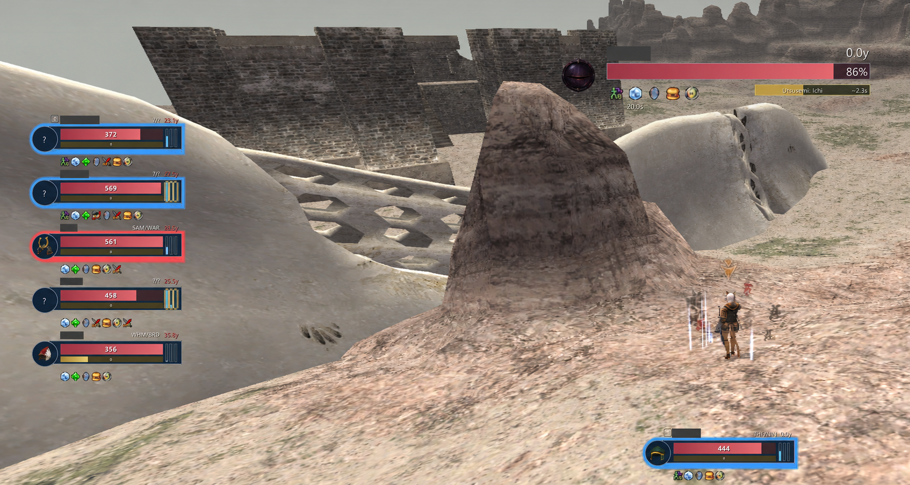
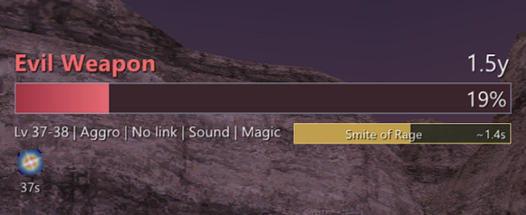
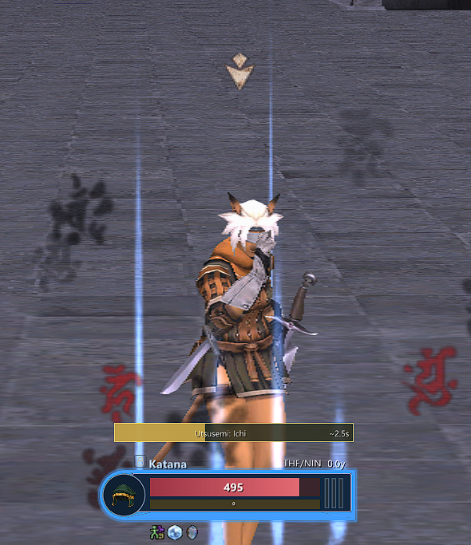
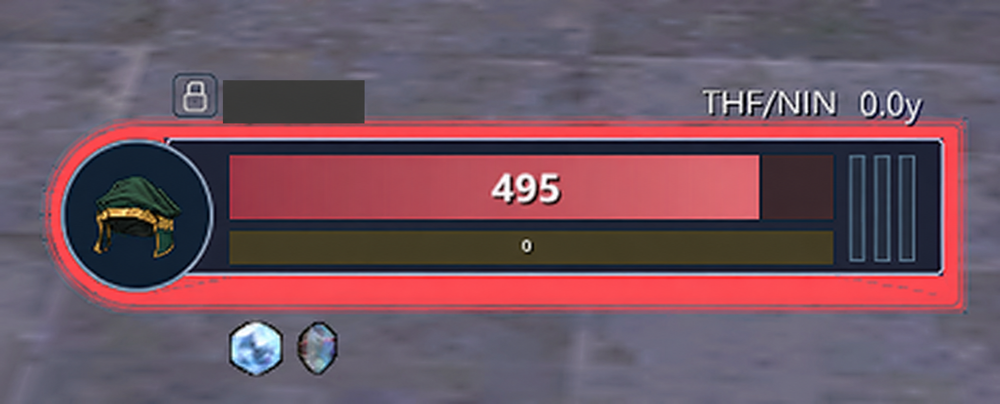

# PartyXI

A replacement for the native party frames, with a target bar and optional combat TP bar.

## Update notes - changes since approved 0.1.73

| Build | Changes |
| --- | --- |
| 0.1.74 | /sea and expanded chat menu hiding toggles; automatic Utsusemi/Third Eye tracking without per player selection.|
| 0.1.75 | Removed the target bar hover popup. |
| 0.1.76 | Changed party HP & MP to current only text.|
| 0.1.77 | Single row party buffs with a 32-icon limit, wider drawing bounds.|
| 0.1.78 | Replaced the portrait protection ring with a translucent full frame shell; added opacity/glow controls and space for buffs below the shell. |
| 0.1.79–0.1.81 | Squared the shell's right edge, expanded visual control ranges, strengthened the glow, and refined edge clearance and portrait alignment. |
| 0.1.82 | Removed HP/MP text prefixes. |
| 0.1.83 | Centered current HP/MP values. |
| 0.1.84 | Added detachable P0 with independent saved position/scale, settings open dragging, reset control, and gap free P1–P5 stacking. | 
| 0.1.85 | Changed minute based duration text from 1m20 to 1:20; short timers retain 22s format. | 
| 0.1.86-0.1.88 | Added player target of target support when client data is available. Along with other minor polygon adjustments. | 
---

## Version 1.0.0
This marks PartyXI’s stable release, bringing together updated party frames, a detachable player frame, clearer shadow and protection indicators, menu hiding, and improved target displays.

Additional features include:

1. A customizable target cast bar that can stay attached or move independently.
2. A separate player cast bar with its own position, size, and scale.
3. Estimated cast progress and remaining time using Phoenix timing data.
4. Cast completion and interruption detection.
5. Party HP and MP visibility throughout the same zone, even outside entity range.
6. An attached cast bar that overlays target effects without shifting them.

 

---

**Version status:** 0.1.73 is the last Phoenix XI approved release. This README describes the current 1.0.0 build and its changes since 0.1.73; it does not imply approval of the newer features.

## Installation and settings

1. Download the current release from [Releases](https://github.com/GreasyGearBox/PartyXI/releases).
2. Extract the `partyxi` folder into your Phoenix XI `addons` folder.
3. Load it with `/addon load partyxi`. After replacing addon files, use `/addon reload partyxi`.

Open settings with `/pxi` or `/partyxi`. Positions, scales, and settings are saved.

## Party frames

- Displays HP, MP, TP, job/subjob, and distance to party members.
- Shows debuffs beside each frame and buffs underneath.
- Hides during cutscenes, on the map, and in menus such as the equipment screen.
- Current HP and MP values are centered in their bars. Resource text has no HP/MP prefixes or maximum value denominators. Unknown values remain marked rather than guessed.
- Buffs extend to the right in a single row, up to **32 icons per member**. Additional buffs do not wrap or push the next player's frame down. Icons beyond the display limit are not shown; the screen edge can still limit visibility.
- Click a member's name or resource panel to target them during normal play.

### Detach your own player frame

Under **Party**, enable **Detach own player frame** to separate your own frame (P0) from P1–P5.

- Your frame has its own saved position and **Own frame scale**.
- While settings are open, drag your name to move your frame. Drag the first remaining party member's name to position the party group separately.
- The remaining party frames close the gap left by P0.
- Turning detachment off restores the normal party stack. The detached position and scale are retained for next time.
- Your detached frame keeps its buffs, protection indicator, resource displays, and shared menu hiding behavior.

## Menu hiding

Under **Menus**, choose **Selected obstructing menus** or **All noncombat menus**. The selected menu mode provides saved category toggles for:

- Equipment / check
- Inventory / storage
- Player / NPC trade
- Auction house
- Delivery / send boxes
- Map
- **Search / sea**
- **Expanded chat log**

Search hiding includes `/sea` and `/sea all` result menus. Expanded chat hiding targets the full chat history panel; ordinary chat input is excluded. 

The **Also hide personal TP arc** setting controls whether the arc follows menu hiding. Party visibility also governs the target/subtarget displays and the detached own player frame. Existing cutscene and native interface hiding remain available.

For troubleshooting, `/pxi menudebug` toggles menu name reporting in chat.

## Target and subtarget bars

- Displays target HP, name, distance, and an independently positioned subtarget bar.
- Shows Phoenix XI mob data, including level range, aggro, linking, and detection methods when available.
- Shows observed buffs/debuffs with estimated remaining durations. Unknown durations stay blank; effects active before observation may be missing.
- Duration labels retain their full text and shrink when necessary instead of becoming `...`.

## Personal TP arc

An independently movable and scalable TP display, with readiness pulses and configurable rise/drain animation.

Open settings to show the arc for positioning, including while sheathed. Drag it while settings are open even if normal play positions are locked; closing settings restores the position lock.

## Utsusemi and Third Eye tracking

Enable **Shadow Tracking (Utsusemi / Third Eye)** under **Effects** to automatically track observed protection for party members. Individual player name selection is no longer required.

- **Blue shell:** Utsusemi or Third Eye is observed active.
- **Red shell:** previously observed protection is confirmed lost. The red state remains until protection is observed again or tracking continuity is reset.
- **No shell:** no protection has been observed, or the state is unknown/unavailable. Missing data is not treated as confirmed protection loss.
- **Blink is intentionally not tracked.**

The translucent shell surrounds the portrait and resource panel, with a rounded left edge, a square right edge, and layered glow. Buff icons remain outside it. Protection tracking uses observed status effects; it does not infer remaining shadow counts.

An optional, separately movable red `-PLAYERNAME` alert announces confirmed protection loss for three seconds.

## Sneak Attack tracking

Shows an estimated Sneak Attack cooldown countdown in the party member's portrait.

